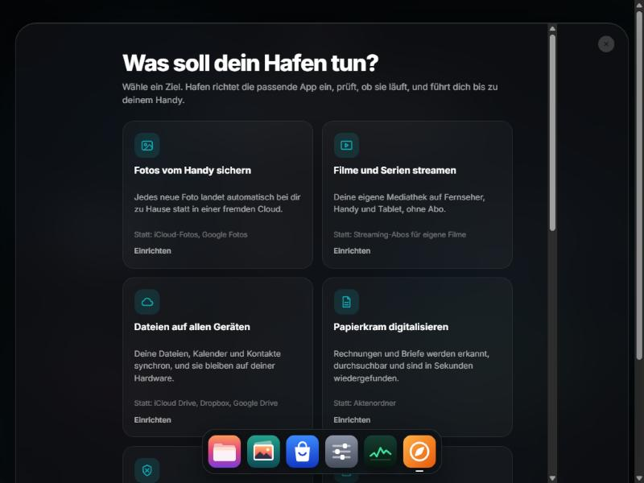

# Hafen

**Dein eigener Server für zu Hause, für den du kein Administrator sein musst.**

Fotos, Filme, Dateien und Passwörter liegen bei den meisten Menschen in fremden Clouds, mit monatlichen Kosten und ohne Kontrolle. Ein Heimserver löst das, ist aber bisher ein Hobby für Leute, die gern Konfigurationsdateien lesen. Hafen macht daraus etwas, das man wirklich benutzt: Du sagst, was du erreichen willst, und Hafen richtet es ein, prüft es und passt danach darauf auf.

Hafen läuft auf einem Mac mit Apple Silicon, also auch dort, wo Umbrel nicht läuft.

## Was Hafen für dich tut

- **Ziele statt App-Listen.** „Fotos vom Handy sichern“, „Filme streamen“, „Werbung im WLAN blocken“ und mehr. Hafen prüft, ob dein Rechner das schafft, installiert die passende App, wartet, bis sie wirklich antwortet, und führt dich mit QR-Code bis aufs Handy.
- **Gesundheit.** Alle fünf Minuten prüft Hafen, ob Docker läuft, jede App antwortet, Speicher frei ist und die letzte Sicherung aktuell ist. Hängt eine App, startet Hafen sie selbst neu. Oben links steht in einem Satz, wie es deinem Server geht.
- **Backups, denen du trauen kannst.** Einstellungen, App-Daten, Datenbanken und auf Wunsch deine Dateien, täglich auf eine externe Festplatte. Jede Sicherung wird nach dem Schreiben auf Lesbarkeit geprüft.
- **Prüfstand.** Hafen testet Store-Apps in echtem Docker auf deinem Rechner und zeigt im Store, was hier tatsächlich läuft.
- **120 Apps im Store**, von Nextcloud bis Home Assistant, dazu eigene Apps per `docker run`-Befehl.
- **Dateien, Freigabe-Links, Papierkorb, Verlauf, Mitteilungen aufs Handy und ein KI-Assistent**, der deinen Server kennt.

## Für wen ist Hafen?

Für alle, die einen Mac übrig haben, ihre Daten zurückholen wollen und keine Lust auf Terminal-Abende haben. Ein Mac mini ist ideal. Ein MacBook geht auch, schläft aber mit geschlossenem Deckel ein, außer ein Monitor ist angeschlossen. Hafen warnt dich vor solchen Stolpersteinen.

Hafen ist fürs Heimnetz gebaut. Stelle es nicht direkt ins offene Internet. Für unterwegs ist Tailscale der richtige Weg, das Ziel „Von unterwegs zugreifen“ führt dich hindurch.



## So läuft Hafen

| | Direkt auf macOS (empfohlen) | Als eigene VM |
|---|---|---|
| Einrichtung | `bash install.sh` | `bash vm/make-vm.sh` + UTM, siehe [vm/README.md](vm/README.md) |
| Docker | Colima (oder OrbStack/Docker Desktop, falls schon da) | Debian 13 mit nativem Docker |
| Adresse | `http://<dein-mac>.local:8420` | `http://hafen.local` |
| Home Assistant | Geräte-Erkennung eingeschränkt | voll, Host-Netzwerk möglich |

## Installation

Du brauchst einen Mac mit Apple Silicon und [Homebrew](https://brew.sh). Dann im Terminal:

```bash
curl -fsSL https://raw.githubusercontent.com/pawelinoHD/hafen/main/get.sh | bash
```

Lieber vorher lesen, was läuft? Lade [hafen.zip](https://github.com/pawelinoHD/hafen/releases/latest) herunter, entpacke es und starte `bash install.sh`.

Das Skript

1. prüft Homebrew und installiert bei Bedarf **Node.js**,
2. nimmt ein laufendes Docker (OrbStack/Docker Desktop) oder installiert **Colima** (schlanke Docker-VM mit Apple-Virtualisierung und Rosetta für x86-Images),
3. kopiert Hafen nach `~/hafen`, die Daten liegen in `~/hafen-daten`,
4. richtet einen **Autostart** ein (LaunchAgent `de.hafen.server`) und öffnet die Oberfläche.

Beim ersten Öffnen legst du Namen und Passwort fest. Danach ist Hafen von jedem Gerät im WLAN erreichbar, auch vom iPhone. Über „Zum Home-Bildschirm“ wird daraus eine App.

Am Netzteil hält Hafen den Mac selbst wach, das kannst du unter **Gesundheit** ändern.

## Apps im Store

120 Apps in 15 Kategorien. Alle Images gibt es für arm64; das wurde bei den neueren Apps direkt an der Registry geprüft. Ob eine App auf deinem Rechner läuft, zeigt der **Prüfstand** unter Gesundheit. Startpasswörter erzeugt Hafen selbst und zeigt sie auf der App-Seite unter **Zugangsdaten** an, wo eine App das erlaubt. Sonst meldet die Gesundheit das Standardpasswort, bis du es geändert hast.

**KI-Tipp für den M1:** Installiere [Ollama](https://ollama.com) direkt auf dem Mac, nicht im Container. Nur dort nutzt es die GPU (Metal). Open WebUI aus dem Store verbindet sich automatisch.

## Ordner

```
~/hafen-daten/
├── config.json        Anmeldung, Einstellungen (Passwort nur als scrypt-Hash)
├── hafen.log          Server-Protokoll
├── apps/<id>/         docker-compose.yml + .env der installierten App
├── eigene-apps/<id>/  selbst angelegte Store-Apps
├── mitteilungen.json, freigaben.json, verlauf.json
├── data/<id>/         Daten der App (bleiben beim Deinstallieren, außer du wählst „Daten löschen“)
└── storage/           Dein Speicher: Downloads, Medien, Musik, Fotos, Dokumente, Hörbücher
```

Mehrere Apps teilen sich `storage/`: Was qBittorrent nach `Downloads` lädt, kannst du nach `Medien/Filme` schieben, und Jellyfin zeigt es an. Wie bei Umbrel.

## Eigene App hinzufügen

Lege einen Ordner `store/<id>/` mit zwei Dateien an:

- `app.json`: `name`, `tagline`, `description`, `category`, `port`, optional `path`, `icon`, `website`, `extraPorts`, `storageDirs`, `credentials`
- `docker-compose.yml`: Diese Variablen stehen zur Verfügung:

| Variable | Inhalt |
|---|---|
| `APP_PORT` | der Port aus `app.json` |
| `APP_DATA_DIR` | `~/hafen-daten/data/<id>` |
| `APP_PASSWORD` / `APP_SECRET` | zufällig, bleibt über Updates gleich |
| `HAFEN_STORAGE` | der gemeinsame Speicher |
| `HAFEN_HOSTS` / `HAFEN_ORIGINS` | Hostnamen bzw. `http://host:port`-Liste (für Trusted-Domains/CSRF) |
| `TZ`, `PUID`, `PGID` | Zeitzone, Benutzer- und Gruppen-ID |

Der Store liest den Ordner bei jedem Aufruf neu ein. Die App erscheint also sofort, ohne Neustart.

## Ausprobieren ohne Docker

```bash
node server.js --demo     # simuliert Installationen, Daten in ~/hafen-demo
```

## Befehle

```bash
launchctl kickstart -k gui/$(id -u)/de.hafen.server   # Hafen neu starten
tail -f ~/hafen-daten/hafen.log                       # Protokoll
colima status                                         # Docker-VM
bash ~/hafen/uninstall.sh                             # Autostart entfernen
```

Passwort vergessen? `config.json` öffnen, den Block `"user"` löschen, Hafen neu starten. Dann richtest du Namen und Passwort neu ein, und die Apps bleiben erhalten.

## Hafen aktualisieren

Gibt es eine neue Fassung, meldet Hafen das. Unter **Einstellungen → Hafen aktualisieren** spielst du sie mit einem Klick ein. Hafen prüft die Prüfsumme, sichert die laufende Fassung nach `~/hafen-daten/aktualisierung/vorige-fassung` und startet neu. Apps und Daten bleiben erhalten, die vorige Fassung holst du im selben Dialog zurück.

Dafür fragt Hafen alle sechs Stunden bei GitHub nach der neuesten Fassung. Dabei gehen keine Daten aus deinem Hafen raus.

Startet Hafen nach einem Update nicht mehr, hilft das Terminal:

```bash
rsync -a --delete ~/hafen-daten/aktualisierung/vorige-fassung/ ~/hafen/ && launchctl kickstart -k gui/$(id -u)/de.hafen.server
```

## Stand des Projekts

Hafen läuft im Alltag auf einem MacBook Air mit M1 (8 GB) unter Colima. Dort wurden der Prüfstand, der Werbefilter und das Sichern und Zurückspielen einer echten Datenbank getestet. Geprüfte Apps stehen in [store-geprueft.json](store-geprueft.json); die übrigen Store-Apps sind noch nicht auf echter Hardware erprobt. Rechne mit Kanten und melde sie gern als [Issue](https://github.com/pawelinoHD/hafen/issues). Sichere wichtige Daten immer zusätzlich.

**Bekannte Eigenheiten unter Colima:** UDP-Ports aus Containern kommen nicht auf dem Mac an. Für den Werbefilter gleicht das eine eingebaute DNS-Brücke aus; Spieleserver mit UDP wie Factorio funktionieren dort noch nicht. Neue Installationen nutzen Apples Netz. Ältere Colima-Installationen können mit Torrent-Apps das Internet aller Container verstopfen; die Gesundheit erkennt das und bietet die Umstellung an.

## Lizenz

Hafen steht unter der [MIT-Lizenz](LICENSE). Fremde Bestandteile stehen in [THIRD-PARTY.md](THIRD-PARTY.md).
